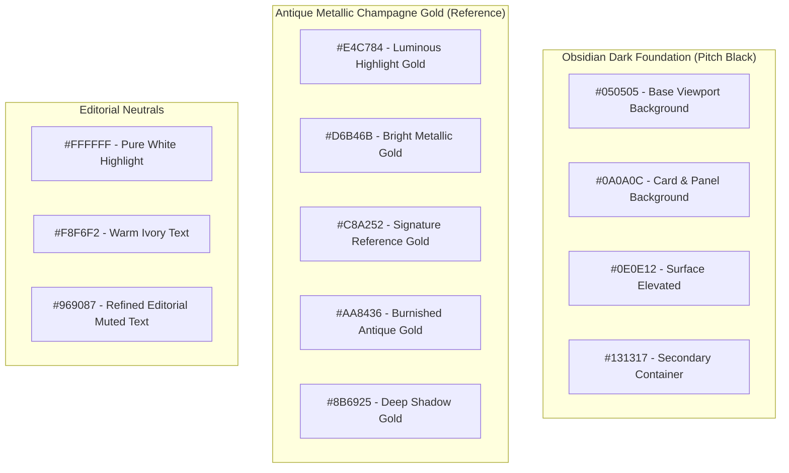

# Bhanu Hair Studio — Frontend Architecture & Design System Master Specification

> **Project:** Bhanu's The Hair Studio (Haute Coiffure & Luxury Unisex Atelier)  
> **Location:** Shop No. 4, Sewak Avenue, Manik Bagh Rd, Palsikar Colony, Indore, Madhya Pradesh 452007  
> **Hours:** Open Daily 10:00 AM – 10:00 PM  
> **Framework:** Next.js (App Router, Turbopack) + React 19 + TypeScript + Tailwind CSS  
> **Document Purpose:** Definitive architectural blueprint, design tokens, UI/UX interaction standards, component catalog, and behavioral guidelines for human engineers and AI coding assistants.

---

## 1. Brand Identity & Design Philosophy

Bhanu Hair Studio is positioned as a **high-end haute coiffure and unisex grooming atelier** in Indore, India. The digital experience rejects generic salon templates in favor of a **cinematic luxury editorial aesthetic** inspired by global luxury fashion houses (Vogue, Bulgari, Celine) and high-performance interactive automotive experiences.

### Core Aesthetic Pillars:
1. **Pitch Obsidian Black Foundations:** Rich, noise-free absolute blacks (`#000000`, `#050505`) that provide maximum contrast and allow metallic accents to glow.
2. **Warm Antique Metallic Gold:** A curated palette centered on antique brass/champagne gold (`#C8A252`, `#D6B46B`), avoiding cheap yellow golds or muddy browns.
3. **Editorial Typographic Precision:** Authoritative uppercase Roman display serifs (`Cinzel`) paired with contemporary geometric sans (`Outfit`) for surgical clarity.
4. **Physical Tactility:** Micro-interactions, interactive WebGL 3D shears, smooth momentum wheel scrolling, and a custom magnetic halo cursor.
5. **Frictionless Conversion:** Every ritual and section seamlessly connects to direct WhatsApp concierge reservation or phone booking.

---

## 2. Color Palette & Design Tokens

Defined in [`tailwind.config.js`](file:///c:/Users/HP/Downloads/bhanu%20hair%20studio/tailwind.config.js) and [`src/app/globals.css`](file:///c:/Users/HP/Downloads/bhanu%20hair%20studio/src/app/globals.css):



### Exact Hex Color Table

| Token | Hex Code | Purpose / Application |
|---|---|---|
| `obsidian-950` | `#050505` | Primary viewport background, video backdrop, modal scrims |
| `obsidian-900` | `#0A0A0C` | Primary card surfaces, input backgrounds |
| `obsidian-850` | `#0E0E12` | Elevated surfaces, nav capsules |
| `surface.DEFAULT` | `#0E0E12` | Default component surface |
| `champagne-300` | `#E4C784` | Cursor dot glow, highlight text, active pills |
| `champagne-400` | `#D6B46B` | Primary interactive gold buttons, active badges, shear metal |
| `champagne-500` | `#C8A252` | Signature reference gold, border accents, decorative rules |
| `champagne-600` | `#AA8436` | Burnished gold borders, gradient endpoints |
| `champagne-700` | `#8B6925` | Deep gold shadows, button active states |
| `ivory-50` | `#FFFFFF` | Primary headlines, high-contrast title text |
| `ivory-100` | `#F8F6F2` | Body text, active link states |
| `muted` | `#969087` | Secondary text, timestamps, captions, inactive nav links |

### Signature Gradients & Utility Classes

```css
/* Metallic Antique Gold Text Gradient */
.text-champagne-gradient {
  background: linear-gradient(135deg, #F8F3E8 0%, #D6B46B 45%, #C8A252 70%, #98752C 100%);
  -webkit-background-clip: text;
  -webkit-text-fill-color: transparent;
}

/* Glassmorphism Panel */
.glass-panel {
  background: rgba(10, 10, 12, 0.75);
  backdrop-filter: blur(20px);
  -webkit-backdrop-filter: blur(20px);
  border: 1px solid rgba(200, 162, 82, 0.18);
}

/* Glassmorphism Card with Deep Obsidian Gradient */
.glass-card {
  background: linear-gradient(150deg, rgba(14, 14, 18, 0.9) 0%, rgba(8, 8, 10, 0.96) 100%);
  border: 1px solid rgba(200, 162, 82, 0.16);
  backdrop-filter: blur(16px);
  -webkit-backdrop-filter: blur(16px);
}
```

---

## 3. Typography System & Font Pairing

Configured in [`src/app/layout.tsx`](file:///c:/Users/HP/Downloads/bhanu%20hair%20studio/src/app/layout.tsx) via `next/font/google`:

```ts
const cinzel = Cinzel({
  subsets: ["latin"],
  variable: "--font-cinzel",
  weight: ["400", "500", "600", "700", "800", "900"],
  display: "swap",
});

const outfit = Outfit({
  subsets: ["latin"],
  variable: "--font-outfit",
  weight: ["300", "400", "500", "600", "700"],
  display: "swap",
});

const cormorant = Cormorant_Garamond({
  subsets: ["latin"],
  variable: "--font-cormorant",
  weight: ["300", "400", "500", "600", "700"],
  style: ["normal", "italic"],
  display: "swap",
});
```

### Hierarchy & Usage Matrix

| Role | Font Family | Class | Typical Styling | Sample Usage |
|---|---|---|---|---|
| **Major Display Headlines** | `Cinzel` | `font-serif` or `font-display` | `uppercase font-light tracking-tight leading-[1.0]` | `"WHERE STYLE BECOMES ART"`, `"YOUR STYLE. OUR CRAFT."` |
| **Italic Accent Words** | `Cinzel` / `Cormorant` | `font-serif italic font-normal` | `text-champagne-400 italic` | `"ART"`, `"OUR CRAFT"`, `"PRECISION"` |
| **Eyebrows & Section Chips** | `Outfit` / `Monospace` | `font-sans font-medium` or `font-mono` | `text-[10px] sm:text-xs uppercase tracking-ultra text-champagne-400` | `"02 / ATELIER TREATMENT DIRECTORY"`, `"ACT I — THE GENESIS"` |
| **Body & Narrative Copy** | `Outfit` | `font-sans font-light` | `text-xs sm:text-sm md:text-base text-muted leading-relaxed` | Studio philosophy, service descriptions |
| **Numerical Data & Counters** | `Cinzel` + `Outfit Mono` | `font-serif` + `font-mono` | `text-2xl font-serif text-champagne-300` | `"10 PM"`, `"30+"`, `"4.9 ★"` |

### Custom Letter-Spacing Tokens
* `tracking-ultra`: `0.28em` (Used for chapter eyebrows, section numbers)
* `tracking-editorial`: `0.22em` (Used for sub-headlines and nav items)
* `tracking-widest`: `0.18em` (Used for buttons and badges)

---

## 4. Custom Luxury Magnetic Cursor System

Implemented in [`src/components/LuxuryCursor.tsx`](file:///c:/Users/HP/Downloads/bhanu%20hair%20studio/src/components/LuxuryCursor.tsx):

### How It Works:
1. **Device Pointer Detection:** Only mounts if `window.matchMedia("(pointer: fine)").matches` is true. Mobile touchscreens are never encumbered.
2. **Default OS Cursor Eradication:**
   * In `globals.css`, high-specificity rules set `cursor: none !important` across `html, body, *, *::before, *::after, a, button, input, select, textarea, canvas, [role="button"], [tabindex], .cursor-pointer`.
   * On mount, `LuxuryCursor.tsx` applies `document.documentElement.style.cursor = "none"` and injects a dynamic style element to guarantee zero cursor bleed or double cursors.
3. **Dual Ring-and-Dot Mechanics:**
   * **Core Dot (`dotRef`):** Immediately tracks `e.clientX` / `e.clientY` with zero lag via `translate3d`.
   * **Magnetic Halo (`ringRef`):** Follows the mouse using physics lerp (`ringPos += (mousePos - ringPos) * 0.22`) within a 60/120fps `requestAnimationFrame` loop.
4. **Context-Aware Magnetic States:**
   * Hovering over canvas / 3D shears $\to$ expands ring with text `"DRAG 3D"`.
   * Hovering over the horizontal reel $\to$ expands ring with text `"DRAG"`.
   * Hovering over gallery images $\to$ expands ring with text `"EXPAND"`.
   * Hovering over buttons/links $\to$ expands halo ring subtly.

---

## 5. Complete Component Architecture & Catalog

The application is structured into modular components in [`src/components/`](file:///c:/Users/HP/Downloads/bhanu%20hair%20studio/src/components/):

```text
src/
├── app/
│   ├── globals.css          # Design system CSS tokens, glassmorphism, cursor rules
│   ├── layout.tsx           # Google Fonts (Cinzel, Outfit, Cormorant), SEO metadata
│   └── page.tsx             # Root page assembly
├── components/
│   ├── Navbar.tsx           # Floating glass pill header, live IST status dot
│   ├── CinematicHero.tsx    # Desktop pinned video scrub & momentum flywheel
│   ├── MobileHero3D.tsx     # Mobile (<768px) WebGL 3D interactive sculpture
│   ├── TheStudio.tsx        # Asymmetric editorial studio narrative, stats & manifesto
│   ├── MarqueeRibbon.tsx    # Continuous marquee ticker bridge
│   ├── TreatmentDirectory.tsx # 30-service unisex catalog with horizontal reel only
│   ├── SignatureExperience.tsx # 3 chapters + interactive 3D Japanese Scissors
│   ├── ThreeScissorsCanvas.tsx # Three.js procedural Hitachi 440C Cobalt shears
│   ├── GallerySection.tsx   # Look archive, duotone filters, comparison, lightbox
│   ├── SkincareSection.tsx  # "Beyond Hair" facial & clinical treatment accordion
│   ├── TestimonialsSection.tsx # Editorial quote carousel with star ratings
│   ├── BookingSection.tsx   # WhatsApp/Call/Directions CTA hub & inquiry form
│   ├── Footer.tsx           # Brand footer, sitemap, disciplines, and social links
│   └── LuxuryCursor.tsx     # Custom hardware-accelerated magnetic cursor
├── config/
│   ├── salon.config.ts      # Single source of truth for services, copy, contact & hours
│   └── scenes.ts            # Timeline thresholds & text overlays for Hero acts
```

---

### Component Specifications

#### 1. `Navbar.tsx`
* **Type:** Client Component (`"use client"`)
* **Behavior:** Fixed top header (`pointer-events-none`), nested container (`pointer-events-auto`). On scroll (`window.scrollY > 50`), transitions from subtle translucency to deep frosted glass (`bg-obsidian-950/85 backdrop-blur-2xl border-champagne-500/20`).
* **Live Studio Status:** Calculates Indian Standard Time (UTC + 5:30). If current IST hour is between 10:00 and 22:00 (10 AM to 10 PM), displays a pulsing emerald dot (`OPEN TIL 10PM`); otherwise displays amber (`OPENS 10AM`).
* **Branding:** Gold scissor emblem rotated `-45deg` (rotates to `0deg` on hover) with `"BHANU'S THE HAIR STUDIO"` and subtitle `"HAIR STUDIO · INDORE"`.
* **Mobile Drawer:** Fullscreen modal drawer with staggered links and direct WhatsApp CTA.

#### 2. `CinematicHero.tsx` & `scenes.ts`
* **Type:** Client Component (`"use client"`)
* **Platform:** Active on Desktop ($\ge 768px$). Hidden on mobile.
* **Physics Model:** Detailed in [`HERO_SCROLL_ARCHITECTURE.md`](file:///c:/Users/HP/Downloads/bhanu%20hair%20studio/HERO_SCROLL_ARCHITECTURE.md).
* **Overlay System:** Decoupled constant Act 01–04 selector (`absolute bottom-8 left-1/2 -translate-x-1/2 z-30`) that never shifts. Centered display titles with half-sine easing.

#### 3. `MobileHero3D.tsx`
* **Type:** Client Component (`"use client"`)
* **Platform:** Active on Mobile ($< 768px$).
* **Features:** Mounts a Three.js WebGL scene with an armillary spherical knot rendered with metallic champagne materials (`MeshStandardMaterial` with metalness `0.85` and roughness `0.25`). Responds to touch drag and device orientation.

#### 4. `TheStudio.tsx`
* **Content:** Architectural introduction to the Palsikar Colony salon.
* **Layout:** Asymmetric 12-column grid. Left 6 columns house the manifesto blockquote from Master Stylist Bhanu, numerical stat tiles (`10 PM`, `30+`, `4.9 ★`), and link to rituals. Right 6 columns house architectural interior imagery with duotone grading.
* **Animations:** GSAP ScrollTrigger horizontal gold line expansion (`scaleX: 0` to `1`), image parallax scrub (`y: 30` to `-25`).

#### 5. `TreatmentDirectory.tsx`
* **Showcase Type:** **Exclusive Horizontal Reel Only** (Bento grid was intentionally deprecated per user request).
* **Service Count:** 30 comprehensive unisex rituals mapped from [`src/config/salon.config.ts`](file:///c:/Users/HP/Downloads/bhanu%20hair%20studio/src/config/salon.config.ts).
* **Features:**
  * Real-time search query filter (matches service names, descriptions, and category tags).
  * Category filter pills with count badges (`All Rituals`, `Hair & Beard`, `Texture & Rebonding`, `Colour & Balayage`, `Bridal & Aesthetics`, `Skin & Facials`, `Spa & Waxing`).
  * Horizontal drag & trackpad swipe reel with `scroll-snap-type: x mandatory`.
  * Prev / Next glide buttons with smooth programmatic scroll.
  * Gold dynamic scroll progress bar (`scrollProgress * 100%`).
  * Each card includes category number, ritual duration badge, sensory description, and direct WhatsApp booking link with prefilled URL-encoded message.

#### 6. `SignatureExperience.tsx` & `ThreeScissorsCanvas.tsx`
* **Concept:** Interactive showcase of Japanese scissor craftsmanship.
* **Chapters:** 3 interactive chapters:
  1. *Chapter 01: The Consultation* (Cranial geometry, facial symmetry).
  2. *Chapter 02: Structural Architecture* (Hitachi 440C shears, dry point cutting).
  3. *Chapter 03: The Liquid Silk Infusion* (Molecular repair, thermal seal).
* **Three.js Interactive Scissors:**
  * Procedurally constructed dual-blade 3D shears with pivot screw, thumb ring, finger tang, and finger ring.
  * Material: Gold metallic physical shader (`metalness: 0.92`, `roughness: 0.18`).
  * Interactive features: OrbitControls drag rotation, click-to-snip mechanical sound/animation, blade angle tension buttons (`Precision`, `Texturize`, `Scissor-Over-Comb`).

#### 7. `GallerySection.tsx`
* **Look Archive:** 6 curated signature transformations.
* **Features:** Category filtering tabs (`All`, `Men's`, `Women's`, `Colour`, `Treatments`), duotone film-grade overlays to ensure unified color temperature across stock photography, interactive before/after transformation slider with split-handle drag, and full-screen modal lightbox.

#### 8. `SkincareSection.tsx`
* **Title:** `"BEYOND HAIR"`
* **Content:** Clinical facials, Hydra-dermabrasion, and skin detox rituals.
* **Composition:** Split layout with active treatment imagery on the left, and an interactive protocol accordion on the right detailing step-by-step clinical methodology.

#### 9. `TestimonialsSection.tsx`
* **Type:** Client Component (`"use client"`)
* **Features:** Editorial serif quotation carousel featuring verified Indore client experiences. Auto-advances every 6 seconds, pauses automatically when hovered, and includes 5-star gold ratings with navigation arrows and dot indicators.

#### 10. `BookingSection.tsx`
* **Purpose:** Primary multi-channel reservation hub.
* **Direct Actions:**
  * Primary WhatsApp reservation button with prefilled greeting.
  * Direct phone call button (`tel:+919179436566`).
  * Google Maps directions link targeting Shop No. 4, Sewak Avenue, Palsikar Colony.
* **Studio Information:** Full address, operating hours (10 AM to 10 PM daily), and a quick appointment request inquiry form.

#### 11. `Footer.tsx`
* **Components:** Brand signature, quick sitemap navigation, disciplines catalog, live social links (Instagram, Facebook), copyright notice, and smooth `"Back to Top"` scroll trigger.

---

## 6. Single Source of Truth: Configuration Architecture

All salon data, contact information, hours, pricing metadata, and copy are centralized in [`src/config/salon.config.ts`](file:///c:/Users/HP/Downloads/bhanu%20hair%20studio/src/config/salon.config.ts).

### Key Configuration Schema
```ts
export const SALON_CONFIG: SalonConfig = {
  identity: {
    brandName: "Bhanu's The Hair Studio",
    brandSub: "Palsikar",
    tagline: "Haute Coiffure & Luxury Unisex Atelier",
    city: "Indore",
    state: "Madhya Pradesh",
    country: "India",
  },
  contact: {
    phone: "+919179436566",
    displayPhone: "+91 91794 36566",
    whatsappNumber: "919179436566",
    whatsappPrefill: "Hello Bhanu's The Hair Studio Palsikar, I would like to book a luxury session.",
    email: "concierge@bhanuhairstudio.com",
    address: {
      line1: "Shop No.4, Sewak Avenue",
      line2: "7, Manik Bagh Rd, Palsikar Colony",
      city: "Indore",
      state: "Madhya Pradesh",
      pincode: "452007",
      fullAddress: "Shop No.4, Sewak Avenue, 7, Manik Bagh Rd, Palsikar Colony, Indore, Madhya Pradesh 452007",
      mapsUrl: "https://maps.google.com/?q=Shop+No.4,+Sewak+Avenue,+7,+Manik+Bagh+Rd,+Palsikar+Colony,+Indore,+Madhya+Pradesh+452007",
    },
    hours: [
      { days: "Monday – Sunday", time: "10:00 AM – 10:00 PM", status: "Open Daily" },
    ],
  },
  ...
};
```

---

## 7. Guidelines for AI Assistants & Developers

When modifying or expanding this codebase, strictly adhere to the following rules:

1. **Preserve Color & Aesthetic Strictness:**
   * Never introduce generic pure colors (e.g., standard Tailwind `bg-blue-500`, `bg-red-500`, or bright yellow `bg-yellow-400`).
   * Always use `obsidian-950` (`#050505`) for backgrounds and `champagne-300`/`400`/`500` for gold accents.
2. **Do Not Reintroduce Bento Grid:**
   * The Treatment Directory must remain **Reel Only**. Do not add grid switchers or bento toggles back into [`TreatmentDirectory.tsx`](file:///c:/Users/HP/Downloads/bhanu%20hair%20studio/src/components/TreatmentDirectory.tsx).
3. **Cursor Rules:**
   * Never remove the cursor overrides in `globals.css` or `LuxuryCursor.tsx`. The custom gold magnetic halo must be the only cursor visible on fine-pointer devices.
4. **Hero Scroll Stability:**
   * The Act 01–04 indicator in [`CinematicHero.tsx`](file:///c:/Users/HP/Downloads/bhanu%20hair%20studio/src/components/CinematicHero.tsx) must remain positioned at `absolute bottom-8 left-1/2 -translate-x-1/2 z-30` completely separate from the text container to prevent vertical jumping.
   * Do not insert hard `v.currentTime = targetTime` calls during forward or backward video playback; always rely on the flywheel momentum and adaptive rewind stepping.
5. **Centralized Data:**
   * Do not hardcode salon phone numbers, addresses, or hours inside component JSX. Always import them from `SALON_CONFIG` in [`src/config/salon.config.ts`](file:///c:/Users/HP/Downloads/bhanu%20hair%20studio/src/config/salon.config.ts).
