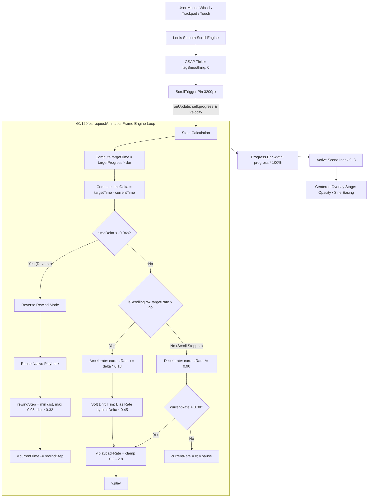

# Cinematic Hero Scrolling Engine — Technical Architecture & Improvement Guide

> **Target File:** [`src/components/CinematicHero.tsx`](file:///c:/Users/HP/Downloads/bhanu%20hair%20studio/src/components/CinematicHero.tsx)  
> **Configuration:** [`src/config/scenes.ts`](file:///c:/Users/HP/Downloads/bhanu%20hair%20studio/src/config/scenes.ts)  
> **Author/Maintainer:** Senior UI/UX & Frontend Architecture Team  
> **Document Purpose:** Complete technical deconstruction of the pinned scroll video playback engine, deceleration physics, reverse scrubbing, overlay orchestration, and actionable paths for future enhancements.

---

## 1. Executive Overview

The Hero section employs a **Dual-Engine Architecture**:
1. **Mobile (< 768px):** Renders [`MobileHero3D.tsx`](file:///c:/Users/HP/Downloads/bhanu%20hair%20studio/src/components/MobileHero3D.tsx), a lightweight WebGL Three.js armillary sculpture with fluid touch inertia. Mobile browsers frequently throttle background video decoders and restrict high-speed scrubbing to conserve battery, making WebGL a superior mobile choice.
2. **Desktop (≥ 768px):** Renders [`CinematicHero.tsx`](file:///c:/Users/HP/Downloads/bhanu%20hair%20studio/src/components/CinematicHero.tsx), a pinned hardware-accelerated video experience controlled by page scroll momentum and velocity.

Unlike naive video scrubs that directly bind `video.currentTime = progress * duration` on every wheel tick (which causes video decoders to freeze and drop frames due to inter-frame keyframe latency), this engine operates as a **Kinetic Flywheel**:
* Scrolling injects momentum into a playback speed accumulator.
* The browser plays the video natively forward at variable speeds (`playbackRate`).
* When scrolling stops, the video does not abruptly halt or jump to a frame; it applies exponential decay friction to gradually glide to a stop.
* When scrolling backward, an adaptive reverse scrub eases the video backward in sync with the user's gesture.

---

## 2. High-Level Architecture Diagram



---

## 3. Core Component Dependencies

| Dependency | Version / Source | Responsibility in Hero |
|---|---|---|
| **`lenis`** | `^1.x` | Smooth wheel scroll normalization, lerp physics, and sub-pixel scrolling. |
| **`gsap`** | `^3.x` | Coordinates the tick loop and RAF rendering. |
| **`gsap/ScrollTrigger`** | `^3.x` | Pins the 100vh viewport container over `3200px` of virtual scroll distance. Computes normalized `progress` (`0.0` to `1.0`) and instantaneous scroll `velocity`. |
| **HTML5 `<video>`** | Browser Native | Decodes and renders the 44-second commercial MP4 stream. |

---

## 4. Deep Dive: The Mathematical Physics Model

### 4.1. Pinning Mechanics
```ts
const scrollLength = 3200; // Virtual scroll distance in pixels

const st = ScrollTrigger.create({
  trigger: containerRef.current,
  start: "top top",
  end: `+=${scrollLength}`,
  scrub: 0.1,
  pin: true,
  pinSpacing: true,
  anticipatePin: 1,
  onUpdate: (self) => { ... }
});
```
* **Virtual Length:** `3200px` provides comfortable tactile pacing for a ~44-second video (roughly 72px of scroll per second of video).
* **`scrub: 0.1`:** A small scrub smoothing factor ensures GSAP's reported `self.progress` responds with minimal input lag while filtering out abrupt trackpad spikes.
* **`anticipatePin: 1`:** Pre-calculates pinning bounds to prevent visible layout jumps when scrolling quickly into the hero from the top of the document.

---

### 4.2. Deterministic Scroll Synchronization & Lerp Easing
Instead of running a non-deterministic video playback velocity engine, the hero uses **deterministic position mapping**:
$$\text{targetTime} = \text{clamp}(\text{scrollProgress}, 0, 1) \times \text{videoDuration}$$

Scroll position is the single source of truth. The video element is kept strictly **paused** (`v.pause()`) at all times.

To give mouse-wheel notches and trackpad impulses a silky, physical feel without causing desynchronization, the engine applies sub-pixel exponential convergence (Apple-style inertia) in the unified RAF loop:
```ts
const diff = targetProgressRef.current - currentProgressRef.current;
if (Math.abs(diff) > 0.00008) {
  currentProgressRef.current += diff * 0.14; // Smooth exponential convergence
} else {
  currentProgressRef.current = targetProgressRef.current;
}

const progress = Math.max(0, Math.min(1, currentProgressRef.current));
const targetTime = Math.max(0, Math.min(dur - 0.05, progress * dur));
requestSeek(targetTime);
```
* When scrolling ceases, `diff` drops exponentially to zero, settling the video frame precisely on the target time with zero lingering drift or overshoot.
* Both forward and backward scroll share the exact same mathematical convergence.

---

### 4.3. Coalesced Hardware Video Seeking Engine (Single-Flight Lock)
Standard video scrubs freeze because assigning `video.currentTime` on every frame floods the browser's hardware video decoder. While a seek is in flight (`video.seeking === true`), subsequent seek commands cause decoder pipeline stalls, keyframe decode latency, and frame drops.

**The Solution:** A coalesced, single-flight seek engine with zero seek queue backlog:
```ts
const requestSeek = (time: number) => {
  const video = videoRef.current;
  if (!video || video.readyState < 1) return;

  // Skip micro-jitter (< 1/120th second)
  if (Math.abs(time - lastRequestedTimeRef.current) < 0.008) return;
  lastRequestedTimeRef.current = time;

  // If a hardware seek is currently in flight, COALESCE: queue the latest time
  if (isSeekingRef.current) {
    pendingTimeRef.current = time;
    return;
  }

  // No seek in flight: issue immediately and lock
  isSeekingRef.current = true;
  pendingTimeRef.current = null;

  try {
    if ("fastSeek" in video && typeof (video as any).fastSeek === "function") {
      (video as any).fastSeek(time);
    } else {
      video.currentTime = time;
    }
  } catch {
    video.currentTime = time;
  }
};

const onSeeked = () => {
  isSeekingRef.current = false;
  // If a newer scroll position arrived while the decoder was processing the previous frame:
  if (pendingTimeRef.current !== null) {
    const nextTime = pendingTimeRef.current;
    pendingTimeRef.current = null;
    requestSeek(nextTime);
  }
};
```
* **Performance Guarantee:** At most **ONE** seek request is ever in flight at any given moment.
* **Rapid Scrolling:** Intermediate obsolete seeks are discarded automatically; only the latest frame is processed.
* **Stop Scrolling:** The decoder immediately settles on the exact resting scroll position without lagging or rolling.

---

### 4.4. Zero React 19 Re-rendering During Scroll
In high-frequency scroll animations, calling `setState` inside 60/120fps loops triggers continuous virtual DOM reconciliations, resulting in main-thread jank.

The engine uses direct DOM refs for:
* **Bottom progress line:** `progressBarRef.current.style.transform = \`scaleX(\${progress})\`` (Hardware GPU layer, zero reflow).
* **Scene Overlays:** `sceneRefs.current[i].style.opacity` and `transform = translate3d(0, \${translateY}px, 0)`.
* **Act Buttons:** Cached button classList toggles that only update when `activeIdx` changes.

---

### 4.5. Boundary Protection & Unpinning
* Clamping is continuous via `Math.max(0, Math.min(dur - 0.05, progress * dur))`.
* At `progress = 1.0`, the video rests on the final frame, unpinning naturally into the next section (`#studio`) with zero jump, zero white space, and zero scroll locking.

---

## 5. Overlay Architecture & Act Selector Stability

### 5.1. Decoupled Fixed Act Selector
* **Problem Solved:** When overlay text faded out, standard flexbox layouts recalculated heights, causing the Act selector to jump up into the middle of the screen.
* **Implementation:** The Act selector is positioned completely independently of the text stage:
```tsx
{/* Constant Fixed Bottom Act Selector */}
<div className="absolute bottom-8 left-1/2 -translate-x-1/2 z-30 pointer-events-auto flex items-center justify-center px-2">
  <div className="flex items-center gap-1.5 glass-panel px-3.5 py-1.5 rounded-full border border-champagne-500/25 backdrop-blur-md shadow-lg">
    {HERO_CONFIG.scenes.map((s, i) => (
      <button key={s.id} onClick={() => jumpToScene(s.start)}>
        ACT 0{i + 1}
      </button>
    ))}
  </div>
</div>
```

### 5.2. True Center Text Stage
All 4 scene titles are rendered within a centered stage:
```tsx
<div className="absolute inset-0 w-full h-full z-10 pointer-events-none flex items-center justify-center p-6 md:p-12">
  <div className="relative w-full max-w-4xl min-h-[300px] sm:min-h-[340px] flex items-center justify-center text-center">
    {HERO_CONFIG.scenes.map((scene) => {
      // Half-sine wave opacity curve for smooth peak transitions
      // translateY creates subtle entrance and exit float
      return (
        <div className="absolute inset-0 flex flex-col items-center justify-center text-center transition-opacity duration-200 pointer-events-none">
          ...
        </div>
      );
    })}
  </div>
</div>
```

---

## 6. Video Asset Optimization Guidelines

The current video source is streamed from Cloudinary:
```text
https://res.cloudinary.com/deepcnbrz/video/upload/v1791999245/gemini_generated_video_91c3ab41_kukymd.mp4
```

### Critical Encoding Requirements for Smooth Scrubbing
For an HTML5 video to scrub without stuttering, the video encoding profile must have a **dense keyframe distribution**:
1. **GOP Size (Group of Pictures):** Standard streaming videos use a GOP size of 120–250 (1 keyframe every 4–8 seconds). This is disastrous for scrolling.
2. **Recommended FFmpeg Profile for Interactive Scroll:**
   ```bash
   ffmpeg -i input.mp4 -c:v libx264 -preset slow -crf 22 \
     -x264opts keyint=15:min-keyint=15:no-scenecut \
     -an -movflags +faststart optimized_hero_scrub.mp4
   ```
   * `keyint=15`: Forces an I-frame (keyframe) every 15 frames (every 0.5s at 30fps).
   * `min-keyint=15`: Prevents variable keyframe spacing.
   * `no-scenecut`: Maintains strict predictable keyframe spacing.
   * `-movflags +faststart`: Moves the `moov` atom (metadata index) to the front of the file, allowing immediate byte-range seeking without waiting for full download.

---

## 7. Actionable Roadmap for Future Improvements

If you wish to advance the hero scrolling engine to the highest possible tier, consider these 4 evolution paths:

### Path A: Canvas Pre-Decoded Image Sequence Scrubbing (Apple-Style)
* **Concept:** Instead of playing an MP4 video, extract the video into 300–450 optimized WebP or AVIF frames (`frame_001.webp`, `frame_002.webp` at 1080p, ~40KB each).
* **Implementation:** Load images into an HTML5 `<canvas>` via `requestAnimationFrame`. Draw `ctx.drawImage(images[frameIndex], 0, 0)`.
* **Advantage:** 100% instant bidirectional scrubbing with zero decoder latency, zero keyframe pauses, and 120fps hardware synchronization on both forward and reverse scroll.

### Path B: WebCodecs API Hardware Demuxing
* **Concept:** Use the modern `VideoDecoder` API available in modern Chromium/Safari browsers.
* **Implementation:** Demux MP4 packets directly in a Web Worker and render decoded frames to an `OffscreenCanvas`.
* **Advantage:** Unlocks programmatic sub-frame random access while keeping the lightweight file size of a single compressed video file.

### Path C: Spring Physics Integration (`framer-motion` or custom RK4 solver)
* **Concept:** Replace the simple damping multiplier (`currentRate *= 0.90`) with a Runge-Kutta 4th order (RK4) spring solver.
* **Advantage:** Provides physical spring bounce, natural settling stiffness, and tactile mass when flinging the scroll wheel.

### Path D: Dynamic Video Resolution Switching
* **Concept:** Serve a 720p 30fps dense-GOP video for laptops and integrated GPUs, and a 1080p 60fps video for high-DPI desktop displays using `<source media="...">` or network condition detection.
