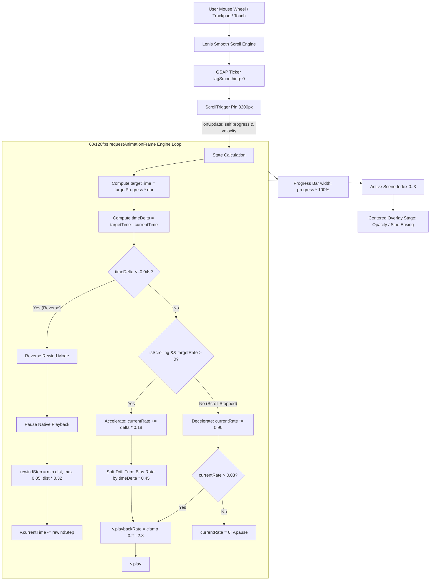

# Cinematic Hero Scrolling Engine — Technical Architecture & Improvement Guide

> **Target File:** [`src/components/CinematicHero.tsx`](file:///c:/Users/HP/Downloads/bhanu%20hair%20studio/src/components/CinematicHero.tsx)  
> **Configuration:** [`src/config/scenes.ts`](file:///c:/Users/HP/Downloads/bhanu%20hair%20studio/src/config/scenes.ts)  
> **Author/Maintainer:** Senior UI/UX & Frontend Architecture Team  
> **Document Purpose:** Complete technical deconstruction of the pinned scroll video playback engine, deceleration physics, reverse scrubbing, overlay orchestration, and actionable paths for future enhancements.

---

## 1. Executive Overview

The Hero section employs a **Dual-Engine Architecture**:
1. **Mobile (< 768px):** Renders [`MobileHero3D.tsx`](file:///c:/Users/HP/Downloads/bhanu%20hair%20studio/src/components/MobileHero3D.tsx), a lightweight WebGL Three.js armillary sculpture with fluid touch inertia. Mobile browsers frequently throttle background video decoders and restrict high-speed scrubbing to conserve battery, making WebGL a superior mobile choice.
2. **Desktop (≥ 768px):** Renders [`CinematicHero.tsx`](file:///c:/Users/HP/Downloads/bhanu%20hair%20studio/src/components/CinematicHero.tsx), a pinned hardware-accelerated video experience controlled by page scroll momentum and velocity.

Unlike naive video scrubs that directly bind `video.currentTime = progress * duration` on every wheel tick (which causes video decoders to freeze and drop frames due to inter-frame keyframe latency), this engine operates as a **Kinetic Flywheel**:
* Scrolling injects momentum into a playback speed accumulator.
* The browser plays the video natively forward at variable speeds (`playbackRate`).
* When scrolling stops, the video does not abruptly halt or jump to a frame; it applies exponential decay friction to gradually glide to a stop.
* When scrolling backward, an adaptive reverse scrub eases the video backward in sync with the user's gesture.

---

## 2. High-Level Architecture Diagram



---

## 3. Core Component Dependencies

| Dependency | Version / Source | Responsibility in Hero |
|---|---|---|
| **`lenis`** | `^1.x` | Smooth wheel scroll normalization, lerp physics, and sub-pixel scrolling. |
| **`gsap`** | `^3.x` | Coordinates the tick loop and RAF rendering. |
| **`gsap/ScrollTrigger`** | `^3.x` | Pins the 100vh viewport container over `3200px` of virtual scroll distance. Computes normalized `progress` (`0.0` to `1.0`) and instantaneous scroll `velocity`. |
| **HTML5 `<video>`** | Browser Native | Decodes and renders the 44-second commercial MP4 stream. |

---

## 4. Deep Dive: The Mathematical Physics Model

### 4.1. Pinning Mechanics
```ts
const scrollLength = 3200; // Virtual scroll distance in pixels

const st = ScrollTrigger.create({
  trigger: containerRef.current,
  start: "top top",
  end: `+=${scrollLength}`,
  scrub: 0.1,
  pin: true,
  pinSpacing: true,
  anticipatePin: 1,
  onUpdate: (self) => { ... }
});
```
* **Virtual Length:** `3200px` provides comfortable tactile pacing for a ~44-second video (roughly 72px of scroll per second of video).
* **`scrub: 0.1`:** A small scrub smoothing factor ensures GSAP's reported `self.progress` responds with minimal input lag while filtering out abrupt trackpad spikes.
* **`anticipatePin: 1`:** Pre-calculates pinning bounds to prevent visible layout jumps when scrolling quickly into the hero from the top of the document.

---

### 4.2. Forward Playback & Soft Drift Trimming
Traditional video scrubs freeze because they continuously assign `video.currentTime = value`. In H.264/H.265 video encoding, frames are stored as **I-frames** (keyframes) and **P/B-frames** (deltas). Seeking to non-keyframes forces the browser decoder to discard its hardware buffer, seek back to the nearest keyframe, and decode forward. This stalls the pipeline.

**Our Solution:** The video plays natively via `video.play()`. As the user scrolls, we vary `video.playbackRate`:

```ts
const velocity = self.getVelocity(); // Pixels per second

if (velocity > 20) {
  isScrollingRef.current = true;
  // Velocity is mapped to playback rate between 0.6x and 2.6x
  targetPlaybackRateRef.current = Math.min(2.6, Math.max(0.6, velocity * 0.0013));
}
```

In the RAF loop:
```ts
currentRate += (targetRate - currentRate) * 0.18; // Smooth acceleration easing

// Soft Drift Trimming
if (timeDelta > 0.1) {
  const driftBias = Math.max(-0.4, Math.min(0.6, timeDelta * 0.45));
  currentRate = Math.max(0.1, currentRate + driftBias);
}

v.playbackRate = Math.min(2.8, Math.max(0.2, currentRate));
if (v.paused) v.play().catch(() => {});
```
* If the video lags behind the scroll position (`timeDelta > 0.1`), `driftBias` temporarily elevates `playbackRate` by up to `+0.6x`, seamlessly catching up to the scroll position without ever issuing a hard seek!
* If the video gets slightly ahead, `driftBias` gently reduces speed to allow the scroll to catch up.

---

### 4.3. The Flywheel Deceleration Model (Spin-Down on Scroll Stop)
When the user ceases scrolling:
1. `scrollStopTimerRef` fires after `140ms` of inactivity, setting `isScrollingRef.current = false` and `targetPlaybackRateRef.current = 0`.
2. The engine switches into flywheel decay:
```ts
currentRate *= 0.90; // Exponential friction decay per frame
currentPlaybackRateRef.current = currentRate;

if (currentRate > 0.08) {
  v.playbackRate = Math.min(2.8, Math.max(0.2, currentRate));
  if (v.paused) v.play().catch(() => {});
} else {
  if (!v.paused) v.pause();
  currentPlaybackRateRef.current = 0;
}
```
* **Visual Result:** Instead of snapping or jerking to a stop, the video visibly decelerates across ~300–400ms (`1.8x` → `1.4x` → `0.9x` → `0.4x` → `0.1x` → `0.0x`), simulating physical rotational inertia.

---

### 4.4. Adaptive Reverse Scrubbing
Because web browsers do not support negative playback rates (`v.playbackRate = -1.0` throws `NotSupportedError` in Chromium and WebKit), reverse scrolling must manipulate `v.currentTime`.

```ts
if (timeDelta < -0.04) {
  if (!v.paused) v.pause();
  currentPlaybackRateRef.current = 0;

  const dist = Math.abs(timeDelta);
  if (!v.seeking && currentTime > 0.02) {
    // Adaptive step: scales with distance, decays as it converges
    const rewindStep = Math.min(dist, Math.max(0.05, dist * 0.32));
    const nextTime = Math.max(0, currentTime - rewindStep);
    try {
      v.currentTime = nextTime;
    } catch {}
  }
}
```
* **Adaptive Scaling:** If the user scrolls up vigorously (`dist = 5s`), `rewindStep` is large (`~1.6s` per step), rewinding the video in real time.
* **Convergence Deceleration:** As `currentTime` approaches `targetTime`, `dist` approaches `0`, causing `rewindStep` to smoothly shrink down to `0.05s`, eliminating overshoot and jitter.

---

### 4.5. Hard Boundary Protection (Zero Scroll Leaking)
To prevent the video from playing beyond the pinned section into the rest of the website:
```ts
// End boundary: Lock video to end frame and pause
if (targetProgress >= 0.99) {
  currentPlaybackRateRef.current = 0;
  if (!v.paused) v.pause();
  if (Math.abs(v.currentTime - (dur - 0.05)) > 0.2 && !v.seeking) {
    try { v.currentTime = dur - 0.05; } catch {}
  }
} 
// Start boundary: Lock video to first frame and pause
else if (targetProgress <= 0.005) {
  currentPlaybackRateRef.current = 0;
  if (!v.paused) v.pause();
  if (v.currentTime > 0.05 && !v.seeking) {
    try { v.currentTime = 0; } catch {}
  }
}
```

---

## 5. Overlay Architecture & Act Selector Stability

### 5.1. Decoupled Fixed Act Selector
* **Problem Solved:** When overlay text faded out, standard flexbox layouts recalculated heights, causing the Act selector to jump up into the middle of the screen.
* **Implementation:** The Act selector is positioned completely independently of the text stage:
```tsx
{/* Constant Fixed Bottom Act Selector */}
<div className="absolute bottom-8 left-1/2 -translate-x-1/2 z-30 pointer-events-auto flex items-center justify-center px-2">
  <div className="flex items-center gap-1.5 glass-panel px-3.5 py-1.5 rounded-full border border-champagne-500/25 backdrop-blur-md shadow-lg">
    {HERO_CONFIG.scenes.map((s, i) => (
      <button key={s.id} onClick={() => jumpToScene(s.start)}>
        ACT 0{i + 1}
      </button>
    ))}
  </div>
</div>
```

### 5.2. True Center Text Stage
All 4 scene titles are rendered within a centered stage:
```tsx
<div className="absolute inset-0 w-full h-full z-10 pointer-events-none flex items-center justify-center p-6 md:p-12">
  <div className="relative w-full max-w-4xl min-h-[300px] sm:min-h-[340px] flex items-center justify-center text-center">
    {HERO_CONFIG.scenes.map((scene) => {
      // Half-sine wave opacity curve for smooth peak transitions
      // translateY creates subtle entrance and exit float
      return (
        <div className="absolute inset-0 flex flex-col items-center justify-center text-center transition-opacity duration-200 pointer-events-none">
          ...
        </div>
      );
    })}
  </div>
</div>
```

---

## 6. Video Asset Optimization Guidelines

The current video source is streamed from Cloudinary:
```text
https://res.cloudinary.com/deepcnbrz/video/upload/v1791999245/gemini_generated_video_91c3ab41_kukymd.mp4
```

### Critical Encoding Requirements for Smooth Scrubbing
For an HTML5 video to scrub without stuttering, the video encoding profile must have a **dense keyframe distribution**:
1. **GOP Size (Group of Pictures):** Standard streaming videos use a GOP size of 120–250 (1 keyframe every 4–8 seconds). This is disastrous for scrolling.
2. **Recommended FFmpeg Profile for Interactive Scroll:**
   ```bash
   ffmpeg -i input.mp4 -c:v libx264 -preset slow -crf 22 \
     -x264opts keyint=15:min-keyint=15:no-scenecut \
     -an -movflags +faststart optimized_hero_scrub.mp4
   ```
   * `keyint=15`: Forces an I-frame (keyframe) every 15 frames (every 0.5s at 30fps).
   * `min-keyint=15`: Prevents variable keyframe spacing.
   * `no-scenecut`: Maintains strict predictable keyframe spacing.
   * `-movflags +faststart`: Moves the `moov` atom (metadata index) to the front of the file, allowing immediate byte-range seeking without waiting for full download.

---

## 7. Actionable Roadmap for Future Improvements

If you wish to advance the hero scrolling engine to the highest possible tier, consider these 4 evolution paths:

### Path A: Canvas Pre-Decoded Image Sequence Scrubbing (Apple-Style)
* **Concept:** Instead of playing an MP4 video, extract the video into 300–450 optimized WebP or AVIF frames (`frame_001.webp`, `frame_002.webp` at 1080p, ~40KB each).
* **Implementation:** Load images into an HTML5 `<canvas>` via `requestAnimationFrame`. Draw `ctx.drawImage(images[frameIndex], 0, 0)`.
* **Advantage:** 100% instant bidirectional scrubbing with zero decoder latency, zero keyframe pauses, and 120fps hardware synchronization on both forward and reverse scroll.

### Path B: WebCodecs API Hardware Demuxing
* **Concept:** Use the modern `VideoDecoder` API available in modern Chromium/Safari browsers.
* **Implementation:** Demux MP4 packets directly in a Web Worker and render decoded frames to an `OffscreenCanvas`.
* **Advantage:** Unlocks programmatic sub-frame random access while keeping the lightweight file size of a single compressed video file.

### Path C: Spring Physics Integration (`framer-motion` or custom RK4 solver)
* **Concept:** Replace the simple damping multiplier (`currentRate *= 0.90`) with a Runge-Kutta 4th order (RK4) spring solver.
* **Advantage:** Provides physical spring bounce, natural settling stiffness, and tactile mass when flinging the scroll wheel.

### Path D: Dynamic Video Resolution Switching
* **Concept:** Serve a 720p 30fps dense-GOP video for laptops and integrated GPUs, and a 1080p 60fps video for high-DPI desktop displays using `<source media="...">` or network condition detection.
